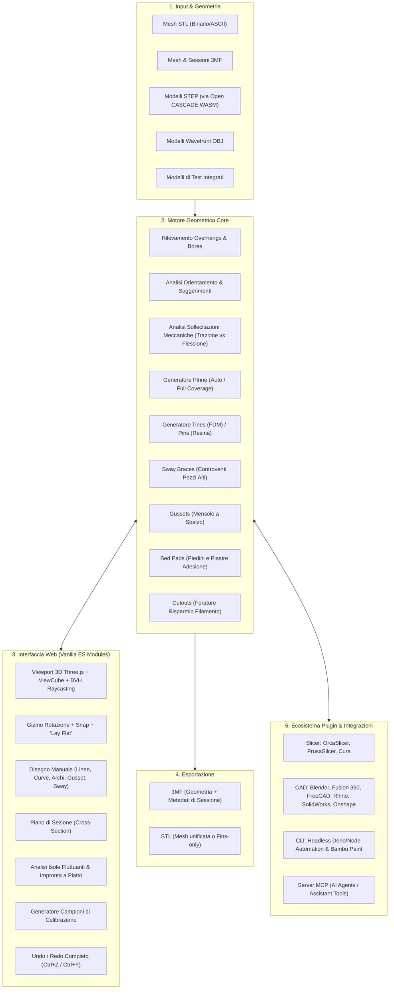

# Mappa delle Funzionalità - Supporti 3D (printfins.com)

> Documento di analisi funzionale e architetturale del progetto **Supporti 3D** ([RazorCopter/support-fins](https://github.com/RazorCopter/support-fins)).

---

## 1. Visione e Concetto Chiave

**Supporti 3D** è un motore geometrico open-source (MIT) per la generazione di **supporti strutturali a "pinna" rimovibili a strappo (breakaway fins)**, incorporati direttamente nella mesh 3D (file STL o 3MF).

### Obiettivo principale
1. **Massimizzazione della resistenza meccanica:** La stampa di parti orientate su spigolo o in diagonale garantisce fino a ~3× la resistenza agli sforzi rispetto alla stampa in piano, poiché le linee di layer non coincidono con i piani di rottura.
2. **Supporti integrati nella mesh ("Designed-in Supports"):** I supporti generati dai comuni slicer (griglia, organici, ad albero) creano cicatrici superficiali, sprecano materiale e dipendono dal singolo software/macchina. Con Supporti 3D, le pinne sono solidi chiusi incorporati nella geometria 3D: il file esportato è **slicer-agnostic e printer-agnostic**.
3. **Approccio "Gap & Grab" (Spaziatura e Presa):**
   - **Fin Body (Pareti verticali):** Pareti sottili distanziate di una tolleranza minima (es. 0.2 mm) dal pezzo.
   - **Tines (Denti di presa orizzontali):** Ponticelli dell'altezza di un singolo layer stampati in continuo (senza retrazioni) che fondono nel pezzo per impedire il ribaltamento e si spezzano per fatica con una semplice flessione manuale.

---

## 2. Diagramma Funzionale dell'Architettura



---

## 3. Mappa Dettagliata delle Funzionalità

### 3.1. Elaborazione Geometria e Analisi Preliminare
- **Importazione Multiformato:**
  - `STL` (binario o testuale).
  - `3MF` (con conservazione/ripristino sessione completa, rotazioni e parametri).
  - `STEP` (conversione lato browser via `occt-import-js` compilato in WebAssembly da Open CASCADE).
  - `OBJ` (mesh poligonali standard).
- **Diagnostica Mesh:**
  - Controllo di chiusura e tenuta stagna (*watertight / manifold check*).
  - Conteggio triangoli, bounding box in millimetri, stima del volume.
  - Rilevamento delle *Floating Islands* (isole e porzioni di mesh sospese nel vuoto).
- **Analisi Overhangs:**
  - Calcolo dell'angolo di sbalzo configurabile (default 45°, regolabile da 30° a 70°).
  - Colorazione predittiva in rosso dei poligoni critici direttamente nel viewport.
  - **Filtro Fori Ciechi e Condotti Piccoli (`HOLE` classification):** Riconoscimento intelligente delle cavità con diametro $\le 6\text{ mm}$; vengono escluse dai supporti per evitare che vi rimangano intrappolate pareti inaccessibili, sfruttando la capacità naturale di bridging della stampante.

---

### 3.2. Strumenti di Orientamento e Analisi di Resistenza
- **Orientamento Interattivo:**
  - Gizmo 3D per rotazioni libere o vincolate con snap a passi prefissati.
  - Funzione **"Lay flat on face"**: cliccando su una faccia del modello, il pezzo si orienta allineando tale faccia perfettamente al piano di stampa ($Z=0$).
- **Suggerimenti di Orientamento Automatici:**
  - Algoritmo che valuta le rotazioni alternative e propone 2–3 orientamenti ottimali, evidenziando i compromessi (altezza pezzo, area di contatto al piatto, quantità di overhangs).
- **Analisi della Resistenza Meccanica (Strength Scoring):**
  - Posizionamento di un vettore forza/carico direttamente sulla superficie del modello.
  - Selettore del tipo di sollecitazione:
    - **Trazione pura ("Pull apart"):** valuta la resistenza allo scollamento dei layer.
    - **Flessione/Leva ("Lever / Bending"):** valuta il momento flettente rispetto all'asse di stampa.
  - Punteggio dinamico dell'orientamento in base al tipo di carico impostato.

---

### 3.3. Algoritmi e Tipologie di Supporto Geometrico

| Tipologia di Supporto | Descrizione | Parametri Chiave | Modulo Corrispondente |
|---|---|---|---|
| **Breakaway Walls** | Parete verticale continua che si innalza dal piatto e si modella al millimetro sull'intradosso della superficie | Spessore parete, gap dal pezzo (default 0.2 mm), estensione | `web/fins.js`, `web/fins/fill.js`, `web/fins/shortwalls.js` |
| **Tines (FDM)** | Ponticelli orizzontali dello spessore di un layer che penetrano leggermente nel pezzo per ancorarlo | Densità tines (`tineDensity`: 0–100%), altezza layer (`layerHeight`: 0.08–0.6 mm) | `web/prop/tines.js`, `docs/FIN-SPEC.md` |
| **Pins (Resina / SLA)** | Perni conici/piramidali verticali che penetrano nel pezzo, specifici per la trazione dei piatti di stampa resina | Profondità perno (`pinDepth`: 0.05–1 mm), larghezza punta (`pinTipW`) | `web/prop/pins.js`, `web/prop/resinfoot.js` |
| **Sway Braces** | Costolature triangolari verticali di controvento disposte a lama contro i lati verticali per bloccare le oscillazioni | Altezza di presa (`sway.gripFrom`), passo tines (`sway.tineSpacing`), estensione al piatto (`sway.reach`) | `web/sway.js`, `web/swaycolumn.js`, `web/swayhit.js` |
| **Anchor Fins** | Supporti inclinati applicabili a facce inclinate posteriori (fino a 45°) per trattenere pezzi coricati all'indietro | Angolazione, aggancio tines sul dorso | `prototype/anchor/`, `web/ui/walls.js` |
| **Gussets** | Mensole a cuneo che partono a 50° da una parete verticale esistente del pezzo per reggere uno sbalzo sovrastante | Angolo 50°, tines laterali fisse sul fusto, tines superiori | `web/gusset.js`, `tests/gusset.test.js` |
| **Bed Pads** | Piastre/dischi alla base delle pinne o del pezzo per garantire adesione ed evitare il distacco | Stile pad: `off`, `light` (staccabile a brim, 0.12mm offset), `sure` (meccanico), `roundFeet` | `web/fins/pad.js`, `web/prop/foot.js` |
| **Cutouts** | Forature passanti nelle pareti alte per risparmiare tempo e plastica senza compromettere la stampabilità | Pattern: `diamond`, `triangle`, `arch`, `lattice`, `honeycomb` | `web/cutout.js`, `tests/cutout.test.js` |

---

### 3.4. Modalità di Generazione e Disegno Interattivo

1. **Modalità Auto:**
   - Genera automaticamente pareti con tines sotto gli sbalzi ripidi con superficie sufficiente alla presa, e pareti lisce sotto gli sbalzi più leggeri.
2. **Modalità Full Coverage:**
   - Esegue la modalità Auto ed estende la copertura a ogni sbalzo raggiungibile dal piatto (ideale per soffitti piatti e grandi ripiani).
3. **Disegno Manuale (Draw Mode):**
   - **Line:** Traccia una parete rettilinea tra due punti.
   - **Curve / Arc:** Traccia pareti sagomate o ad arco che seguono contorni curvi complessi.
   - **Gusset Placement:** Selezione in due clic (faccia verticale del pezzo $\rightarrow$ punto dello sbalzo da sostenere).
   - **Sway Placement:** Posizionamento manuale con un clic di costolature stabilizzatrici su pareti verticali.
   - **Editing e Rimozione:** Selezione visiva della pinna (evidenziazione color ambra) con rimozione selettiva (tasto `Canc` o `Backspace`), con supporto completo all'Undo/Redo.

---

### 3.5. Strumenti di Ispezione e Utilità nell'Interfaccia Web

- **Piano di Sezione Dinamico (`section.js`):** Slider interattivo per sezionare la vista 3D ad altezza Z variabile, permettendo l'ispezione interna dei gap tra supporto e modello.
- **Visualizzazione dell'Impronta a Piatto (`footprint.js`):** Analisi dell'area effettiva a contatto con il letto riscaldato per valutare il rischio di distacco.
- **Campioni di Calibrazione Integrati (`calibrate.js`):**
  - Download diretto di provini e modelli di test preconfigurati:
    - *Angle coupon*: verifica dell'angolo massimo stampabile senza supporti.
    - *Gap coupon*: test delle tolleranze di stacco (0.15 mm, 0.2 mm, 0.25 mm, 0.3 mm).
    - *Grip coupon*: tenuta meccanica dei tines.
    - *Bore coupon*: verifica del bridging su fori cilindrici.
    - *Cutout coupon*: tenuta dei pattern di alleggerimento.
    - *Pad coupon*: adesione al piatto di diverse tipologie di piedino.
- **Multi-Piatto e Volumi Stampante (`plates.js`, `volume.js`):**
  - Gestione di piatti multipli per progetti composti da più parti.
  - Dimensionamento della griglia con preset delle stampanti più diffuse (Bambu Lab, Prusa, Voron, Creality).
- **Supporto Touch e Dispositivi Mobili (`phone.js`, `tap.js`):** Gestione ottimizzata delle gesture touch per telefoni e tablet.
- **Internazionalizzazione (`i18n.js`):** Supporto per localizzazioni multilingua.

---

## 4. Ecosistema di Integrazione e Plugin

Il progetto è progettato per operare non solo come applicazione web standalone, ma all'interno dell'intero workflow CAD/Slicing:

```
plugins/
├── shared/          # Logica unificata di configurazione (options.json) e bridge JS/Python
├── slicer/
│   ├── orca/        # Script post-processing OrcaSlicer con mapping chiavi JSON
│   ├── prusa/       # Plugin nativo PrusaSlicer 3.0 ("Add a Fin")
│   └── cura/        # Addon per UltiMaker Cura
├── cad/
│   ├── blender/     # Addon Blender con interfaccia nativa e import 3MF
│   ├── fusion/      # Script nativo per Autodesk Fusion 360
│   ├── freecad/     # Modulo/Macro per FreeCAD
│   ├── rhino/       # Plugin per Rhinoceros 8 (CPython 3.9)
│   ├── solidworks/  # Add-in C# .NET nativo per Dassault SolidWorks
│   └── onshape/     # Script FeatureScript per Onshape
├── cli/             # Strumento da riga di comando (CLI Node/Deno) per pipeline CI/CD
└── mcp/             # Server MCP (Model Context Protocol) per assistenti AI
```

### Dettaglio Plugin e Server MCP:
- **CLI (`plugins/cli/support-fins.js`):** Esegue il processamento headless da terminale con flag completi (`--mode`, `--gap`, `--threshold`, `--cutout`, `--sway`, ecc.). Include funzionalità avanzate di "baking" del progetto e supporto ai codici colore Bambu Paint.
- **Server MCP (`plugins/mcp/server.js`):** Espone il motore geometrico a strumenti AI compatibili con Model Context Protocol:
  - Tool `fin_part`: Calcola e incorpora le pinne direttamente nel pezzo, restituendo un file 3MF o STL ed un report testuale sugli sbalzi gestiti.
  - Tool `fins_only`: Genera un file STL contenente esclusivamente i supporti allineati alle coordinate spaziali del file sorgente.

---

## 5. Mappa dei Parametri di Configurazione (`options.json`)

Tutte le interfacce (Web, CLI, Plugin Slicer/CAD, MCP) condividono un unico schema di parametri validati:

| Parametro | Chiave JSON | Range / Valori | Default | Descrizione |
|---|---|---|---|---|
| **Placement mode** | `mode` | `auto`, `full` | `auto` | Modalità posizionamento automatico o copertura integrale |
| **Overhang threshold**| `threshold` | 30° – 70° | `45°` | Angolo critico di sbalzo misurato rispetto al piano |
| **Nozzle diameter** | `nozzle` | 0.2 – 2.0 mm | `0.4 mm` | Diametro ugello stampante (scala spessori pareti e tines) |
| **Tines enable** | `tines` | `true`, `false` | `true` | Abilita o disabilita i denti di presa |
| **Tine grip density** | `tineDensity`| 0 – 100% | `0%` (Light) | Spaziatura e presa dei denti lungo il bordo |
| **Tine direction** | `tineDir` | `horizontal`, `vertical` | `horizontal`| Orizzontale per FDM; Verticale (pin a penetrazione) per Resina |
| **Pin depth** | `pinDepth` | 0.05 – 1.0 mm | `0.1 mm` | Profondità di affondamento dei pin (solo Resina) |
| **Layer height** | `layerHeight` | 0.08 – 0.6 mm | `0.2 mm` | Altezza layer (fondamentale affinché i tines siano 1 layer esatto) |
| **Support gap** | `gap` | 0.1 – 0.4 mm | `0.2 mm` | Luce di stacco tra sommità del supporto e superficie |
| **Bed pad style** | `padStyle` | `off`, `auto`, `light`, `sure` | `auto` | Adesione al piatto per pezzi in appoggio su spigolo |
| **Rounded feet** | `roundFeet` | `true`, `false` | `false` | Arrotondamento degli angoli del piede di appoggio |
| **Cutouts pattern** | `cutout` | `none`, `diamond`, `triangle`, `arch`, `lattice`, `honeycomb` | `none` | Finestrature e alleggerimenti sulle pareti alte |
| **Wide-face coverage**| `coverage` | 0 – 100% | `50%` | Densità delle pareti su superfici piane molto estese |
| **Plate only** | `plateOnly` | `true`, `false` | `false` | Forza il radicamento dei supporti solo sul piatto di stampa |
| **Separate walls** | `separateWalls`| `auto`, `on`, `off` | `auto` | Evita la fusione tra pareti adiacenti (fondamentale per Resina) |
| **Sway braces** | `sway.on` | `true`, `false` | `false` | Abilita i controventi per pezzi alti e snelli |
| **Brace tine spacing**| `sway.tineSpacing`| 2 – 30 mm | `6 mm` | Spaziatura verticale dei tines sui controventi |
| **Brace depth** | `sway.reach` | 5 – 50% | `15%` | Profondità del controvento alla base in % sull'altezza |

---

## 6. Stack Tecnologico e Ambiente di Esecuzione

- **Frontend & Rendering:** Vanilla JavaScript (ES Modules, standard moderno senza bundler/Webpack/Vite), Three.js, Three-Mesh-BVH, CSS3 responsivo.
- **WebAssembly:** `occt-import-js` (kernel CAD Open CASCADE per parsing STEP).
- **Backend / Dev Server:** `dev-server.py` (server HTTP leggero Python 3 con gestione disabilitazione cache).
- **Prototipazione Mesh Math:** Python 3 (`trimesh`, `numpy`, `manifold3d`).
- **Test Suite:** Deno Test Runner (`deno test --allow-read tests/`).
- **Deployment:** Cloudflare Pages (deploy statico istantaneo), container Docker multi-stage (`Dockerfile`, `docker-compose.yml`), proxy Nginx (`nginx.conf`).

